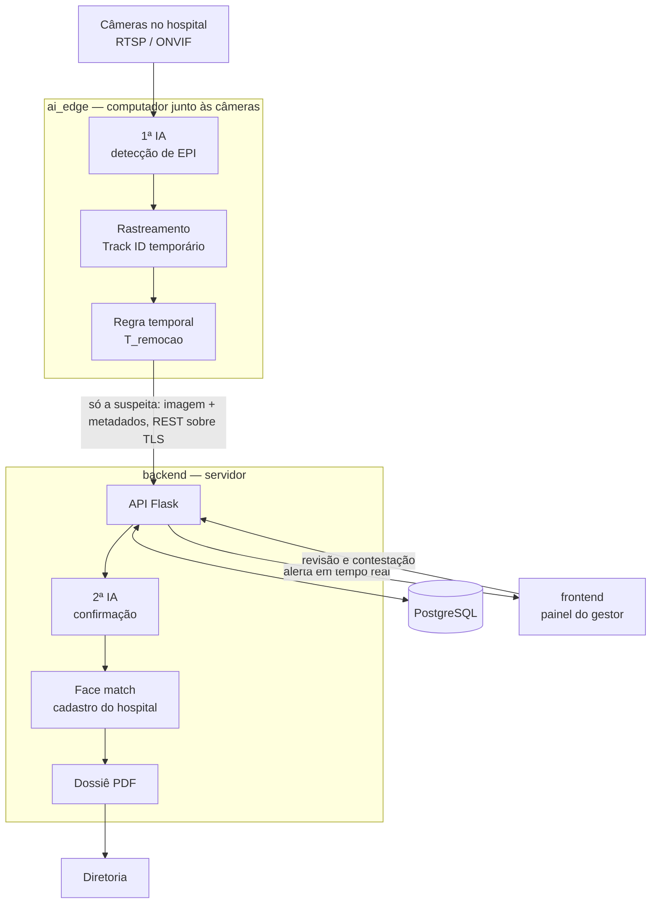

# BioShield AI

**A proteção que dura o procedimento inteiro.**

Sistema de visão computacional que acompanha, em tempo real, o uso de Equipamento de Proteção Individual (EPI) — máscara, luvas, avental, touca e protetor facial — em áreas hospitalares de risco, como UTI, centro cirúrgico e isolamento. Ele percebe tanto quem **entra na área sem o equipamento** quanto quem **o retira durante a permanência**, e avisa a equipe responsável em segundos.

[](https://github.com/KlippellPedro/BioShield-AI/actions/workflows/database-ci.yml)

| | |
|---|---|
| **Contexto** | Projeto acadêmico do Curso Técnico em Desenvolvimento de Sistemas do Senac-RS, na Campanha Senac & Sesc Saúde. Equipe de três pessoas, com orientação do Prof. Miguel Matiolla. |
| **Fase atual** | Arquitetura, modelagem e documentação concluídas. **Banco de dados implementado e testado automaticamente.** As aplicações — IA de detecção, API e painel — estão estruturadas e em implementação. Detalhes em [Estado do projeto](#estado-do-projeto). |
| **Tecnologias** | Python · Flask · PostgreSQL · React · TypeScript · YOLOv8 · Docker · GitHub Actions |

**Por onde começar a ler**

- **Área da saúde, ou sem formação em programação:** [O problema](#o-problema), [Como funciona](#como-funciona-em-linguagem-simples) e [Privacidade e o profissional de saúde](#privacidade-e-o-profissional-de-saúde).
- **Avaliação e recrutamento:** [Estado do projeto](#estado-do-projeto) e [Destaques técnicos](#destaques-técnicos).
- **Desenvolvimento:** [Arquitetura](#arquitetura), [Como executar](#como-executar) e [Documentação](#documentação).
- **Alguma sigla desconhecida:** [Glossário](#glossário-de-siglas).

---

## O problema

As **Infecções Relacionadas à Assistência à Saúde (IRAS)** são infecções que o paciente adquire em consequência do próprio cuidado que recebe no hospital. O EPI é uma das barreiras mais básicas contra elas: protege o paciente de quem o atende e protege o profissional do que está tratando. Por isso seu uso em serviços de saúde é regulado, entre outras normas, pela NR-32, que trata da segurança e saúde no trabalho nesses ambientes.

Verificar se alguém entrou paramentado é relativamente simples. O difícil é o que acontece depois: a máscara abaixada para atender o telefone, a luva retirada para digitar, o protetor facial erguido porque embaçou. São gestos rápidos, muitas vezes automáticos, e acontecem justamente durante o procedimento, quando ninguém está observando. Auditorias presenciais acompanham só uma fração do tempo e não conseguem cobrir cada minuto de cada plantão.

O BioShield AI foi pensado para essa lacuna: **não apenas conferir a entrada, mas manter a verificação durante toda a permanência na área de risco.**

---

## Como funciona, em linguagem simples

Este é o funcionamento projetado. O que já está implementado aparece em [Estado do projeto](#estado-do-projeto).

1. **A câmera observa sem identificar ninguém.** Na operação normal, a imagem é processada com os rostos desfocados. O sistema sabe que há "uma pessoa" usando determinados equipamentos e a acompanha por um número temporário, nunca pelo nome.
2. **A inteligência artificial percebe que falta algo.** Um primeiro modelo, rodando num computador junto às câmeras, reconhece cada EPI e percebe quando um item obrigatório está ausente ou foi retirado.
3. **O sistema espera antes de alarmar.** Passar a mão na frente do rosto ou ajustar a máscara não é uma infração. Por isso existe um tempo de tolerância, o `T_remocao`, configurável por área (5 segundos no exemplo de demonstração): só se o equipamento continuar ausente além desse prazo a situação vira suspeita.
4. **Registra a evidência — e só nesse momento.** No instante da suspeita, e apenas nele, o sistema guarda uma imagem nítida da situação.
5. **Uma segunda IA confere.** No servidor, um modelo mais preciso reavalia a imagem. Se não confirmar a infração, a suspeita é descartada.
6. **Identifica o profissional.** Confirmada a infração, o sistema compara o rosto com o cadastro de funcionários do hospital para obter nome e matrícula.
7. **Avisa e documenta.** O alerta aparece no painel da equipe responsável — a meta é em até 3 segundos — e é gerado um dossiê em PDF do incidente, encaminhado à diretoria.
8. **Uma pessoa revisa.** O gestor pode revisar a identificação feita pela máquina, e o profissional tem o direito de contestá-la.

O sistema reconhece dois tipos de infração:

| Tipo | O que é | Exemplo |
|---|---|---|
| **A — entrada não conforme** | Entrar na área de risco sem algum EPI obrigatório | Entrar no quarto de isolamento sem avental |
| **B — remoção indevida** | Retirar, dentro da área, um EPI que estava sendo usado | Abaixar a máscara na UTI para atender o telefone |

---

## Privacidade e o profissional de saúde

Um sistema que filma e identifica profissionais levanta perguntas legítimas. Estas são as respostas do projeto. As regras de acesso, rastreabilidade, prazo máximo e contestação já estão impostas no banco de dados; o desfoque das imagens e o reconhecimento facial fazem parte das aplicações ainda em implementação.

- **Para que serve, e para que não serve.** A finalidade é prevenir infecção e proteger o paciente. O sistema não é ferramenta de controle de produtividade, de ponto ou de avaliação de desempenho — usar os dados dessa forma violaria o princípio da finalidade da Lei Geral de Proteção de Dados (LGPD).
- **O rosto só é registrado na infração.** Fora dela, a imagem permanece desfocada e ninguém é identificado.
- **O acesso é restrito e deixa rastro.** Só perfis autorizados, e com autenticação em dois fatores, podem ver uma evidência. Cada visualização fica registrada numa trilha de auditoria cujos registros o banco de dados impede de editar.
- **As imagens não ficam guardadas para sempre.** O prazo padrão é de 90 dias e nunca passa de 180 — o banco de dados recusa prazos maiores. A rotina que apaga automaticamente as imagens vencidas está entre as partes a implementar.
- **A decisão da máquina pode ser revista.** A LGPD (art. 20) garante a quem é alvo de uma decisão automatizada o direito de pedir revisão. Toda identificação pode ser contestada, e o registro informa se ela foi feita por uma pessoa ou pela IA.

**O que ainda precisa ser resolvido antes de uso real.** O reconhecimento facial trata dado biométrico, que a LGPD classifica como sensível. Isso exige uma base legal específica, que depende de parecer jurídico da instituição — até lá, o projeto trabalha apenas com dados de demonstração. Outro ponto em aberto: a imagem de uma infração numa UTI pode mostrar também o paciente, que não é alvo do sistema. A análise completa, com nove riscos mapeados e as medidas de cada um, está no [Relatório de Impacto à Proteção de Dados](docs/DPIA_RIPD.md).

---

## Estado do projeto

| Parte | Situação | Detalhe |
|---|---|---|
| Arquitetura e decisões técnicas | **Concluída** | 10 decisões registradas em [`docs/architecture.md`](docs/architecture.md) |
| Banco de dados | **Implementado e testado** | 9 tabelas, regras de segurança e retenção impostas pelo próprio banco, validadas automaticamente a cada envio de código |
| Relatório de Impacto à Proteção de Dados | **Rascunho concluído** | Aguarda revisão jurídica |
| Especificação de requisitos | **v1.3 vigente, emenda para v1.4 escrita** | A emenda registra onde a implementação diverge da versão vigente |
| Integração contínua | **Ativa** | 4 pipelines; o do banco executa testes reais, os demais aguardam o código das aplicações |
| IA de detecção no edge (`ai_edge`) | Estruturada, a implementar | Arquivos e responsabilidades definidos |
| API, 2ª IA e identificação (`backend`) | Estruturada, a implementar | Arquivos e responsabilidades definidos |
| Painel do gestor (`frontend`) | Interface pronta, em modo demonstração | Todas as telas funcionam com dados fictícios; ainda não chamam o backend, e nenhuma credencial é verificada nesse modo |

"Estruturada" significa que cada arquivo já existe e declara, num comentário, o que vai fazer — o contrato está escrito, a lógica ainda não.

**Decisões em aberto**, que não se resolvem só com código:

- **Base legal do tratamento biométrico** — depende de parecer jurídico.
- **Imagem de terceiros** — a proposta da equipe é recortar apenas a região da pessoa monitorada, em vez de guardar o quadro inteiro.
- **Janela de revisão antes do envio do dossiê** — um dossiê enviado à diretoria e depois revogado não desfaz o dano à reputação de quem foi identificado por engano.

---

## Destaques técnicos

O que já está implementado e verificável neste repositório:

- **Segurança imposta pelo banco, não só pela aplicação.** A regra "quem vê evidência precisa de autenticação multifator" é garantida por três gatilhos no PostgreSQL, um para cada caminho pelo qual ela poderia ser contornada: alterar o usuário, o vínculo entre usuário e papel, ou o próprio papel. Fechar só dois deles deixaria a regra aberta pelo terceiro — o que de fato acontecia, e foi corrigido ([ADR-005](docs/architecture.md)).
- **Trilha de auditoria imutável para a aplicação.** Na tabela `audit_logs`, `UPDATE`, `DELETE` e `TRUNCATE` são recusados por gatilho, e os registros apontam para seus alvos sem chave estrangeira, para sobreviver ao expurgo das evidências. O `TRUNCATE` exigiu um gatilho à parte: os gatilhos de linha não disparam com ele, e a trilha podia ser esvaziada até essa brecha ser encontrada e corrigida ([detalhes](database/README.md#por-que-o-truncate-precisou-de-um-gatilho-próprio)).
- **Retenção limitada por restrição no banco.** Uma evidência não pode ser gravada com prazo acima de 180 dias; quem tentar recebe erro, não um aviso.
- **Minimização de dados no modelo.** Quando faltam vários EPIs no mesmo instante, gera-se um evento por EPI, mas uma única imagem, compartilhada entre eles (relação 1:N).
- **Decisão automatizada rastreável.** Cada identificação registra se veio de uma pessoa ou da IA, e uma restrição garante coerência: identificação humana exige autor; identificação por IA exige autor nulo.
- **Testes que provam o que o sistema recusa.** A carga de demonstração tenta sete operações proibidas, uma para cada proteção. A integração contínua quebra o build se alguma for aceita — ou se menos de sete bloqueios responderem, o que denunciaria uma proteção removida por engano.
- **Decisões documentadas, inclusive as abandonadas.** Cada escolha estrutural tem um registro de contexto, decisão e consequência. A ADR-003, superada quando a identificação passou a ser automática, foi mantida como histórico em vez de apagada.

---

## Arquitetura

O sistema é **web e desacoplado** em três aplicações, com um **pipeline de IA em cascata**: um filtro rápido e barato junto às câmeras, e a análise pesada — confirmação e reconhecimento facial — concentrada num único servidor.



**Por que duas IAs em vez de uma.** Analisar vídeo contínuo com um modelo pesado exigiria hardware caro em cada ponto de câmera, ou enviar todo o vídeo pela rede. O filtro no edge descarta a imensa maioria dos quadros ali mesmo, e só as suspeitas seguem para o servidor. Isso reduz custo e latência, e tem um efeito de privacidade: o reconhecimento facial acontece num único lugar, mais fácil de proteger e de auditar do que dezenas de computadores espalhados pelo hospital.

**Por que web, e não um programa instalado.** Implantação simples no hospital, alertas em tempo real nativos no navegador e fronteiras claras entre as partes, o que também organiza o trabalho da equipe. A decisão completa está na [ADR-009](docs/architecture.md).

### Modelo de dados

PostgreSQL 14 ou superior, schema técnico `vigilis`.

| Tabela | O que guarda |
|---|---|
| `zones` | Áreas de risco, os EPIs obrigatórios de cada uma e o tempo de tolerância `T_remocao` |
| `events` | Cada infração detectada, do tipo A ou B |
| `visual_evidence` | A referência à imagem da infração, armazenada cifrada; uma imagem serve a vários eventos do mesmo instante |
| `identifications` | Quem foi identificado, por quem (pessoa ou IA) e se a identificação foi contestada |
| `incident_dossiers` | O dossiê PDF de cada incidente, com ciclo pendente → consolidado |
| `users`, `roles`, `user_roles` | Usuários, perfis de acesso e o vínculo entre eles |
| `audit_logs` | A trilha de acessos e ações, cujos registros não podem ser editados |

O script de criação, com o dicionário de dados completo, está em [`database/schema.sql`](database/schema.sql).

### Tecnologias

| Camada | Tecnologias | Situação |
|---|---|---|
| Banco de dados | PostgreSQL 14+, PL/pgSQL | Em uso |
| Infraestrutura | Docker, Docker Compose, GitHub Actions | Em uso |
| IA no edge | Python, Ultralytics YOLOv8, OpenCV, ByteTrack/DeepSORT | Planejada |
| Backend | Python, Flask, SQLAlchemy, Alembic, Flask-SocketIO, Flask-JWT-Extended, pyotp, ReportLab | Planejada |
| Frontend | React, Vite, TypeScript, Tailwind CSS | Planejada |

---

## Como executar

Hoje a parte executável é o banco de dados. O procedimento abaixo cria o banco, aplica as regras de segurança e roda a carga de demonstração, que tenta sete operações proibidas e mostra o banco recusando cada uma.

**Pré-requisito:** apenas o [Docker](https://docs.docker.com/get-docker/) (no Windows, o Docker Desktop).

**1. Clonar e subir o banco**

```bash
git clone https://github.com/KlippellPedro/BioShield-AI.git
cd BioShield-AI
cp .env.example .env
docker compose up -d db
```

**2. Criar o schema e carregar a demonstração**

Linux, macOS ou WSL:

```bash
docker run --rm --network bioshield-ai_default -v "$PWD:/repo" -w /repo \
  -e PGHOST=db -e PGUSER=postgres -e PGPASSWORD=postgres -e PGDATABASE=bioshield \
  postgres:16 bash scripts/apply_schema.sh --with-seed
```

Windows, no PowerShell:

```powershell
docker run --rm --network bioshield-ai_default -v "${PWD}:/repo" -w /repo `
  -e PGHOST=db -e PGUSER=postgres -e PGPASSWORD=postgres -e PGDATABASE=bioshield `
  postgres:16 bash scripts/apply_schema.sh --with-seed
```

O comando roda o cliente do PostgreSQL dentro de um container, na mesma rede do banco. Assim não é preciso instalar nada além do Docker, e não há conflito com um PostgreSQL que já esteja instalado na máquina usando a porta 5432.

**3. O que você deve ver**

A saída termina com sete confirmações `OK (esperado)`, uma por proteção:

| Operação tentada | Proteção que recusa |
|---|---|
| Consolidar um dossiê sem o profissional identificado | Gatilho de consolidação do dossiê |
| Dar acesso às evidências a um usuário sem autenticação multifator | Gatilho de MFA no vínculo usuário–papel |
| Guardar uma evidência por mais de 180 dias | Restrição de retenção máxima |
| Liberar evidências para um perfil que tem membros sem autenticação multifator | Gatilho de MFA no papel |
| Registrar uma identificação feita pela IA como se tivesse autor humano | Restrição de origem da identificação |
| Apagar de uma vez toda a trilha de auditoria | Gatilho contra `TRUNCATE` na auditoria |
| Desligar a autenticação multifator de quem tem acesso às evidências | Gatilho de MFA no usuário |

Se aparecer `FALHA DO TESTE`, alguma proteção deixou passar o que deveria barrar.

**4. Encerrar**

```bash
docker compose down -v
```

O `-v` apaga também o volume do banco. Sem ele, os dados permanecem para a próxima execução.

> Já tem o cliente `psql` instalado? Com o banco no ar, basta `bash scripts/apply_schema.sh --with-seed`, configurando `PGHOST`, `PGUSER`, `PGPASSWORD` e `PGDATABASE`. Outras opções do script estão em [`scripts/README.md`](scripts/README.md).

---

## Documentação

| Documento | Para que serve |
|---|---|
| [Decisões de arquitetura (ADRs)](docs/architecture.md) | Por que o sistema tem a forma que tem — dez decisões, com contexto e consequências |
| [Relatório de Impacto à Proteção de Dados](docs/DPIA_RIPD.md) | Análise de riscos à privacidade, base legal e direitos dos profissionais monitorados |
| [Emenda ao SRS para a v1.4](docs/SRS_v1.4_emenda.md) | O que muda na especificação de requisitos com a identificação automatizada |
| [Banco de dados](database/README.md) · [Migrações](migrations/README.md) | Schema, carga de demonstração e histórico de mudanças do banco |
| [IA no edge](ai_edge/README.md) · [Backend](backend/README.md) · [Frontend](frontend/README.md) | O contrato de cada aplicação: o que cada arquivo fará |
| [Scripts](scripts/README.md) · [Configuração](config/README.md) · [Integração contínua](.github/README.md) | Ferramentas de apoio ao desenvolvimento |

<details>
<summary><strong>Estrutura completa do repositório</strong></summary>

```
BioShield-AI/
│
├── ai_edge/                      # 1ª IA no edge: detecção de EPI, rastreamento e regra temporal
│   ├── src/
│   │   ├── main.py               # Loop principal: captura → detecção → rastreamento → regras → envio
│   │   ├── config.py             # Parâmetros (FPS, limiares, T_remocao) lidos do .env
│   │   ├── capture/              # Câmera (webcam/RTSP/ONVIF) e desfoque do feed normal
│   │   ├── detection/            # Detector YOLO e mapa de classes de EPI
│   │   ├── tracking/             # Rastreamento com Track ID temporário; Re-ID por silhueta
│   │   ├── rules/                # Associação EPI ↔ pessoa e máquina de estados do T_remocao
│   │   ├── evidence/             # Captura da imagem nítida no instante da suspeita
│   │   └── api_client/           # Envio da suspeita ao backend (REST sobre TLS)
│   ├── models/                   # Pesos do modelo (Git LFS/DVC, fora do git comum)
│   ├── tests/                    # Testes da regra temporal
│   └── Dockerfile · requirements.txt · README.md
│
├── backend/                      # API, 2ª IA, face match, dossiê e segurança
│   ├── app/
│   │   ├── models/               # Mapeamento das tabelas (SQLAlchemy)
│   │   ├── api/                  # Rotas REST: auth, event, evidence, identification, dossier, zone, report
│   │   ├── services/             # Validação de EPI, face match, cadastro hospitalar, PDF, auditoria, retenção
│   │   ├── sockets/              # Alertas em tempo real
│   │   ├── schemas/ · utils/     # Validação de payloads; criptografia e decoradores de acesso
│   │   └── __init__.py · extensions.py · config.py
│   ├── models/                   # Pesos da 2ª IA e do face match (Git LFS/DVC)
│   ├── jobs/purge_evidence.py    # Expurgo por retenção
│   ├── tests/                    # MFA e regras do dossiê
│   └── wsgi.py · Dockerfile · requirements.txt · README.md
│
├── frontend/                     # Painel do gestor: alertas, zonas, revisão, evidências e dossiês
│   ├── src/                      # pages/, components/, hooks/, api/, store/, styles/
│   ├── public/
│   └── index.html · package.json · vite.config.ts · tsconfig.json · Dockerfile · README.md
│
├── database/                     # Implementado
│   ├── schema.sql                # Criação do banco (v1.4) e dicionário de dados
│   ├── seed.sql                  # Carga de demonstração e testes de aceitação
│   ├── migrations/               # Esqueleto do Alembic, para quando o backend gerar migrações
│   └── README.md
│
├── migrations/                   # Migrações SQL aplicadas, em ordem cronológica
│   ├── 2026-06-18_fix-mfa-bypass.sql
│   ├── 2026-06-18_identification-source.sql
│   ├── 2026-09-09_fix-role-privilege-escalation.sql
│   ├── 2026-09-14_fix-audit-truncate.sql
│   └── README.md
│
├── docs/                         # ADRs, Relatório de Impacto e emenda do SRS
├── scripts/                      # apply_schema.sh (implementado), reset_db.sh, run_dev.sh
├── config/                       # Gunicorn, logging e parâmetros de conexão
├── .github/workflows/            # Integração contínua: database, backend, frontend e edge
│
└── docker-compose.yml · .env.example · .gitignore · .dockerignore · Makefile · README.md
```

</details>

---

## Equipe

| Integrante | Frente | Responsabilidade |
|---|---|---|
| **Pedro Nadalon Klippel** | Backend, segurança e banco de dados | API Flask, 2ª IA, reconhecimento facial e integração com o cadastro do hospital; autenticação, persistência, criptografia e expurgo conforme a LGPD |
| **Vinicius Ferrari Niffa** | Engenharia de IA e edge | 1ª IA de detecção de EPI, lógica temporal do `T_remocao` e captura e envio da imagem da infração |
| **Carlos Eduardo Cavalcante da Rocha** | Frontend web e interface | Painel em tempo real, revisão e contestação da identificação automática e visualização dos dossiês |

**Orientação:** Prof. Miguel Matiolla
**Instituição:** Senac-RS — Curso Técnico em Desenvolvimento de Sistemas, Campanha Senac & Sesc Saúde

---

## Glossário de siglas

O projeto cruza quatro vocabulários — engenharia de software, proteção de dados, visão computacional e ambiente hospitalar. Esta é a referência única; cada README de pasta também expande, no seu texto, as siglas que usa. Clique em um grupo para abri-lo.

<details>
<summary><strong>Documentação e requisitos</strong></summary>

| Sigla | Significado | No projeto |
|---|---|---|
| **ADR** | *Architecture Decision Record* — Registro de Decisão de Arquitetura | Cada decisão estrutural, no formato Contexto, Decisão e Consequência. Ficam em [`docs/architecture.md`](docs/architecture.md), numeradas de ADR-001 a ADR-010. |
| **SRS** | *Software Requirements Specification* — Especificação de Requisitos de Software | O documento normativo do produto. Hoje na v1.3, com emenda proposta para a v1.4. |
| **RF** | Requisito Funcional | O que o sistema deve fazer. Ex.: RF-16 (evidência 1:N), RF-17 (identificação). |
| **RNF** | Requisito Não Funcional | Qualidades e restrições. Ex.: RNF-05 (alerta em até 3 s), RNF-19 (MFA obrigatório). |
| **IEEE 830** | Norma do *Institute of Electrical and Electronics Engineers* para especificação de requisitos | Formato seguido pelo SRS. |
| **ISO/IEC 25010** | Norma internacional de qualidade de produto de software | Modelo de qualidade adotado. |

</details>

<details>
<summary><strong>Proteção de dados</strong></summary>

| Sigla | Significado | No projeto |
|---|---|---|
| **LGPD** | Lei Geral de Proteção de Dados Pessoais (Lei 13.709/2018) | Base legal que rege todo o tratamento de imagem e identidade aqui. |
| **DPIA** | *Data Protection Impact Assessment* — Avaliação de Impacto à Proteção de Dados | Nome internacional do relatório. |
| **RIPD** | Relatório de Impacto à Proteção de Dados Pessoais | Nome usado pela LGPD (art. 38) para o mesmo documento. Ver [`docs/DPIA_RIPD.md`](docs/DPIA_RIPD.md). |
| **DPO** | *Data Protection Officer* — Encarregado de Dados | Quem responde pelo tratamento perante a ANPD e os titulares. Existe como papel no controle de acesso do sistema. |
| **ANPD** | Autoridade Nacional de Proteção de Dados | Órgão fiscalizador da LGPD. |

</details>

<details>
<summary><strong>Segurança</strong></summary>

| Sigla | Significado | No projeto |
|---|---|---|
| **MFA** | *Multi-Factor Authentication* — Autenticação Multifator | Obrigatória para qualquer papel que veja evidência (RNF-19). Três gatilhos no banco garantem a regra. |
| **RBAC** | *Role-Based Access Control* — Controle de Acesso Baseado em Papéis | Permissões concedidas a papéis (Operador, DPO, etc.), não a pessoas. |
| **JWT** | *JSON Web Token* — Token Web em formato JSON | Formato do token de sessão emitido pela API. |
| **KMS** | *Key Management Service* — Serviço de Gerenciamento de Chaves | Cofre externo das chaves de criptografia. O banco guarda só a referência, nunca o segredo. |
| **TLS** | *Transport Layer Security* — Segurança da Camada de Transporte | Criptografia em trânsito. Obrigatória no envio da imagem do edge ao backend. |
| **TOTP** | *Time-based One-Time Password* — Senha de Uso Único Baseada em Tempo | Mecanismo do segundo fator (biblioteca `pyotp`). |

</details>

<details>
<summary><strong>Inteligência artificial e visão computacional</strong></summary>

| Sigla | Significado | No projeto |
|---|---|---|
| **IA** | Inteligência Artificial | O sistema usa duas em cascata: a 1ª filtra no edge, a 2ª confirma no backend. |
| **YOLO** | *You Only Look Once* — "você olha só uma vez" | Família de modelos de detecção de objetos em tempo real. É a 1ª IA. |
| **CNN** | *Convolutional Neural Network* — Rede Neural Convolucional | Arquitetura por trás dos detectores de imagem. |
| **MOT** | *Multiple Object Tracking* — Rastreamento de Múltiplos Objetos | Mantém a identidade de cada pessoa entre quadros, via Track ID efêmero. |
| **Re-ID** | *Re-identification* — Reidentificação | Reconhecer a mesma pessoa após uma oclusão. Aqui é por silhueta, **não** por rosto. |
| **IoU** | *Intersection over Union* — Interseção sobre União | Métrica de sobreposição entre caixas delimitadoras; usada para associar cada EPI à pessoa certa. |
| **FPS** | *Frames Per Second* — quadros por segundo | Taxa de processamento do vídeo. |
| **Face match** | Comparação facial | Confronto da imagem da infração com o cadastro do hospital para resolver nome e matrícula. |
| **Track ID** | Identificador de rastreamento | Número temporário dado a cada pessoa em cena. Vive só em memória e não identifica ninguém. |

</details>

<details>
<summary><strong>Arquitetura, rede e infraestrutura</strong></summary>

| Sigla | Significado | No projeto |
|---|---|---|
| **CI** | *Continuous Integration* — Integração Contínua | Verificação automática a cada envio de código: análise estática, testes e validação do banco. Ver [`.github/README.md`](.github/README.md). |
| **API** | *Application Programming Interface* — Interface de Programação de Aplicações | O contrato pelo qual edge e frontend conversam com o backend. |
| **REST** | *Representational State Transfer* — Transferência de Estado Representacional | Estilo arquitetural das rotas HTTP da API. |
| **HTTP** | *HyperText Transfer Protocol* — Protocolo de Transferência de Hipertexto | Protocolo base da web. |
| **SPA** | *Single Page Application* — Aplicação de Página Única | O dashboard: carrega uma vez e atualiza sem recarregar a página. |
| **SSE** | *Server-Sent Events* — Eventos Enviados pelo Servidor | Alternativa ao WebSocket para o servidor empurrar alertas ao navegador. |
| **UI** | *User Interface* — Interface de Usuário | A camada visual do dashboard. |
| **URL** | *Uniform Resource Locator* — Localizador Uniforme de Recursos | Endereço de um recurso na web. |
| **RTSP** | *Real Time Streaming Protocol* — Protocolo de Transmissão em Tempo Real | Protocolo de transmissão de vídeo das câmeras de rede. |
| **ONVIF** | *Open Network Video Interface Forum* | Padrão de interoperabilidade entre câmeras de rede e software de vigilância. |
| **WSGI** | *Web Server Gateway Interface* — Interface de Comunicação com Servidor Web | Interface entre o servidor (Gunicorn) e a aplicação Flask. |
| **edge** | Borda | O computador instalado junto às câmeras, onde roda a 1ª IA. Processar ali evita trafegar vídeo contínuo pela rede. |
| **headless** | Sem interface gráfica | Programa que roda sem tela, só por linha de comando. É o caso do `ai_edge`. |

</details>

<details>
<summary><strong>Banco de dados</strong></summary>

| Sigla | Significado | No projeto |
|---|---|---|
| **SGBD** | Sistema Gerenciador de Banco de Dados | Aqui, PostgreSQL 14 ou superior. |
| **SQL** | *Structured Query Language* — Linguagem de Consulta Estruturada | Linguagem do banco. |
| **DDL** | *Data Definition Language* — Linguagem de Definição de Dados | A parte do SQL que cria tabelas, tipos e restrições. É o conteúdo do bloco em `database/schema.sql`. |
| **PK** | *Primary Key* — Chave Primária | Identificador único de cada linha. |
| **FK** | *Foreign Key* — Chave Estrangeira | Referência de uma tabela a outra. |
| **UUID** | *Universally Unique Identifier* — Identificador Único Universal | Formato das chaves primárias; impede adivinhar registros por sequência numérica. |
| **1:N** | Um para muitos | Relação em que um registro se liga a vários. Uma evidência serve a N eventos (RF-16). |
| **ORM** | *Object-Relational Mapping* — Mapeamento Objeto-Relacional | Camada que traduz tabelas em objetos Python (SQLAlchemy). |
| **trigger** | Gatilho | Rotina que o banco dispara sozinho antes ou depois de uma operação. É como as regras de MFA e retenção são impostas. |

</details>

<details>
<summary><strong>Domínio hospitalar</strong></summary>

| Sigla | Significado | No projeto |
|---|---|---|
| **EPI** | Equipamento de Proteção Individual | Máscara, luvas, avental, touca, protetor facial. O objeto do monitoramento. |
| **UTI** | Unidade de Terapia Intensiva | Uma das categorias de zona de risco. |
| **CCIH** | Comissão de Controle de Infecção Hospitalar | Setor responsável pela conformidade; corresponde a um papel de acesso no sistema. |
| **CRM** | Conselho Regional de Medicina | Registro profissional que aparece na identificação de médicos. |
| **IRAS** | Infecções Relacionadas à Assistência à Saúde | Infecções adquiridas em consequência do cuidado recebido no serviço de saúde. É o problema que o uso correto de EPI ajuda a prevenir. |
| **NR-32** | Norma Regulamentadora nº 32 | Norma de segurança e saúde no trabalho em serviços de saúde, que inclui o uso de EPI. |
| **Oclusão** | Obstrução visual momentânea | Quando algo passa na frente do EPI na imagem (uma mão, outra pessoa). O `T_remocao` existe para não confundir oclusão com remoção. |

</details>

<details>
<summary><strong>Ferramentas e ambiente</strong></summary>

| Sigla | Significado | No projeto |
|---|---|---|
| **LFS** | *Large File Storage* — Armazenamento de Arquivos Grandes | Extensão do Git para versionar arquivos pesados, como os pesos dos modelos de IA. |
| **DVC** | *Data Version Control* — Controle de Versão de Dados | Alternativa ao Git LFS para versionar modelos e conjuntos de dados. |
| **WSL** | *Windows Subsystem for Linux* — Subsistema Windows para Linux | Permite rodar os scripts `.sh` no Windows, que é o ambiente do time. |

</details>

---

## Uso e dados

Projeto acadêmico, mantido público para avaliação e portfólio. Ainda não há licença de uso definida.

O repositório não contém, e não deve conter, dados reais: nada de imagens de evidência, *templates* faciais, segredos de autenticação ou chaves de criptografia — apenas referências a um cofre externo. Os nomes presentes na carga de demonstração são fictícios. O sistema não deve ser usado com pessoas reais antes da definição da base legal e da revisão do Relatório de Impacto pelo Encarregado de Dados da instituição.
